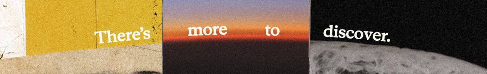

  <picture>
    <source media="(prefers-color-scheme: dark)" srcset="profile-tagline-dark.svg">
    
  </picture>

# Baho

Software engineer based in Turkey. I work on embedded firmware and web apps, and lately a lot on LLM-assisted development and prompt engineering. Outside of that, I'm into amateur radio and low-level hardware.

## Projects

- **[BruceButBetter](https://github.com/Yoursel71/BruceButBetter)** (C++, ESP32-S3): DIY Flipper Zero firmware with Sub-GHz, NFC/RFID, IR, Wi-Fi/BLE, NRF24 and Si5351 support, plus a browser flasher.

- **[LocalRun](https://github.com/Yoursel71/LocalRun)** (Python): local-only viewer for malware and forensics evidence, including Sysmon, Procmon, PCAP, Autoruns, Regshot and FakeNet-NG. Works offline.

- **[alpbahOS](https://github.com/Yoursel71/alpbahOS)** (Linux From Scratch): Turkish-focused Linux distribution designed to make the move from Windows easier.

## Stack

- **Languages:** TypeScript, Python, C++, Kotlin, JavaScript, HTML/CSS
- **Frameworks:** Next.js, React, Node.js, Flask, Jetpack Compose
- **Tools:** Git, Docker, Linux, VS Code, Android Studio, Figma
